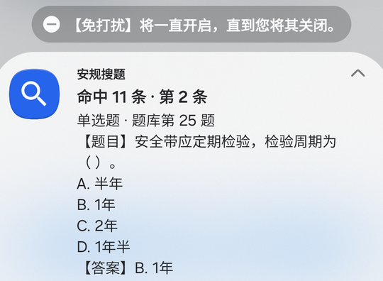

# 安规搜题 · 安卓通知栏搜题

在**通知栏里直接搜索** 119 道安规 / 变电检修题，结果只显示**题目、选项、答案**，**全程不用打开 App**。

- **下载安装**：[quiz-search-1.0.2.apk](dist/quiz-search-1.0.2.apk)（52 KB，Android 8.0+）
- Release 下载：<https://github.com/youyoudezhuzhu/angui-quiz/releases/latest/download/quiz-search-1.0.2.apk>

## 使用步骤

1. 安装并打开「安规搜题」，允许通知权限（Android 13+ 会弹窗请求）。
2. 下拉通知栏，找到「安规搜题 · 通知栏搜题」这条通知，向下展开。
3. 点「搜索」，输入题干关键词（如 `安全带`、`工作票 签发人`、`十不干`），点发送。
4. 通知里直接显示**题目、选项、答案**；一屏能放下的题会一页显示完整内容。
5. 点「关闭」移除通知栏搜题；重新打开 App 可再次开启。开机后会按设置自动恢复。

所有搜题操作都在通知栏完成：**输入 → 结果 → 翻页 → 关闭**，不需要进入 App。

## 截图

| 通知栏内联搜索框 | 搜索结果（题目/选项/答案） | 超长答案分页 |
| --- | --- | --- |
|  |  |  |

## 通知栏长度限制与一页显示

- 安卓系统对展开后的通知正文有**高度上限（约 12 行，且不能滚动）**，超过部分会被系统截断，这是系统限制，不是 App 可以绕过的。
- 本 App 已按「估算显示行数」排版：**119 题中有 115 题可以在一页里完整显示题目 + 全部选项 + 答案**。
- 只有 4 道特别长的题（超长选项或“十不干”这类长答案）需要 2 页，标题会显示 `第 1/2 页`，点「下一条」在同一通知里翻页。
- 无论如何，答案都会同时显示在通知的摘要行里，折叠状态也能直接看到答案。

## 功能

- 题库：119 题（单选 103 · 读图 14 · 问答 2），与网页版题库同源。
- 搜索结果只展示：**题目、全部选项、正确答案**（问答为参考答案）；不显示解析。
- 搜索范围：题干 / 选项 / 问答参考答案；支持空格分隔多关键词；本地模糊匹配（子串 + 二元组相似度 + 关键词覆盖率）。
- 通知栏操作：内联搜索框、下一条（多结果循环 + 超长内容分页）、关闭。
- 完全离线：题库内置在 APK，**不需要网络权限**。
- 开机恢复：监听 `BOOT_COMPLETED`，开机后自动重新显示搜题通知（可在 App 关闭）。
- 极简依赖：纯 Java + 原生 `Notification` / `RemoteInput` API，不使用 AndroidX、Gradle。
- 搜索框实现：Android 原生通知栏不允许常驻可输入控件，本 App 用系统标准的**通知内联回复（Direct Reply）**：展开通知 → 点「搜索」→ 输入框出现在通知栏 → 发送后结果更新到同一条通知。

## 构建

本机无需 Gradle，使用 Android SDK 命令行工具直接构建（aapt2 → javac → d8 → zipalign → apksigner）：

```bash
# 依赖：Android SDK（build-tools 34+，platform android-34）、JDK 8+
ANDROID_HOME=/opt/android-sdk ./build.sh
# 产物：build/quiz-search-1.0.2.apk
```

- `minSdk 26`（Android 8.0），`targetSdk 33`
- 签名：脚本会在 `build/quiz-search.keystore` 生成自签名密钥（不入库）
- APK SHA-256：`00f964191437db53bebbc50fc1e7bd43a3ca0c371172b3ca4837ad3df6309158`

## 目录结构

```
AndroidManifest.xml               清单（通知权限、开机广播、Receiver）
src/com/youyoudezhuzhu/quizsearch/
  MainActivity.java               设置页：开启/关闭通知栏搜题、通知权限
  NotificationHelper.java         构建通知、内联搜索框、调用内容排版
  ContentFormatter.java           正文排版：题目/选项/答案 + 按显示行数分页（纯 Java）
  SearchReceiver.java             处理通知栏里的搜索 / 下一条 / 关闭
  BootReceiver.java               开机后恢复通知栏
  SearchEngine.java               本地搜索（纯 Java，可单测）
  Question.java / QuestionStore.java  题库模型与 assets 读取
  Prefs.java                      状态持久化
assets/questions.json             119 道题（题干/选项/答案/解析/序号）
res/                              图标、布局、主题
tools/TestSearch.java             搜索与排版 JVM 单元测试（36 项）
build.sh                          一键构建 APK
```

## 搜索算法

1. 归一化：去掉空白与中英文标点、转小写；
2. 题干完全匹配 > 题干包含 > 查询包含题干 > 关键词覆盖率（题干/选项/问答参考答案）> 字符二元组 Dice 相似度；
3. 空格分隔的多关键词按覆盖率加分；
4. 结果按得分降序、同分按题库顺序，最多取 20 条。

`tools/TestSearch.java` 覆盖 119 题题干片段召回、关键词、多关键词、空结果、归一化、答案展示、正文不含解析、按行分页（每页 ≤ 12 行）、一页覆盖率（≥95%）与性能（50 次搜索 < 100ms）。
